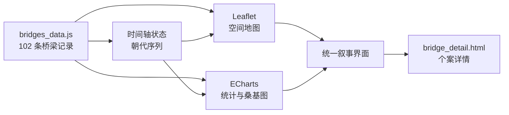

# 千年桥韵 · Echoes of Ancient Bridges

**把 102 座中国古桥放进一张可探索的时空地图。**

[](https://github.com/LB-Y06/ancient-bridges-story-main/actions/workflows/deploy.yml)


[](LICENSE)

[在线演示](https://lb-y06.github.io/ancient-bridges-story-main/) · [数据与结构](#数据与结构) · [本地运行](#本地运行)


## 项目概览

千年桥韵是一个面向中国古代桥梁文化的交互式数据叙事作品。它没有把古桥处理成静态名录，而是从**空间、时间、桥型与材料**四个视角观察 102 座桥梁，让分布规律、技术演变和地方文化在同一个探索路径中发生联系。

| 数据维度 | 当前规模 |
| --- | ---: |
| 古桥记录 | 102 |
| 地理条目 | 98 |
| 桥型 | 6 |
| 主要建材 | 3 |
| 时代标签 | 13 |

## 可以做什么

- 在中国地图上查看古桥点位，并按桥型筛选空间分布。
- 拖动时间轴，观察不同时代的桥梁如何逐步展开。
- 联动查看桥型统计、朝代分布和朝代—桥型桑基图。
- 点击重点桥梁，进入个案页阅读结构、地域与文化解读。
- 通过响应式布局在桌面和移动端浏览完整的视觉叙事。

## 交互架构



页面采用原生 HTML、CSS 和 JavaScript，不需要构建工具。数据与视图之间保持简单、可检查的边界，方便继续补充桥梁记录或替换叙事主题。

## 数据与结构

核心数据位于 [`js/bridges_data.js`](js/bridges_data.js)，每条记录包含名称、朝代、位置、经纬度、桥型、建材和年代等字段。地图边界来自 [`assets/geo/china-provinces.geojson`](assets/geo/china-provinces.geojson)；数据库备份和整理脚本保留在 `bridgedb/`，便于追溯数据来源和后续扩展。

```text
ancient-bridges-story/
├─ index.html                 # 主叙事页面
├─ bridge_detail.html         # 桥梁个案详情
├─ css/style.css              # 视觉系统与响应式布局
├─ js/
│  ├─ bridges_data.js         # 102 条古桥数据
│  ├─ main.js                 # 地图、图表与时间轴交互
│  └─ detail.js               # 个案内容渲染
├─ assets/geo/                # 地理边界数据
├─ libs/                      # 本地化 Leaflet 与 ECharts
└─ docs/                      # README 视觉素材
```

## 本地运行

项目通过 `fetch` 加载 GeoJSON，因此建议启动本地静态服务器，不要直接双击 HTML 文件。

```bash
git clone https://github.com/LB-Y06/ancient-bridges-story-main.git
cd ancient-bridges-story-main
python -m http.server 8000
```

打开 <http://localhost:8000>。地图底图使用在线瓦片，首次加载需要网络连接；统计图表和页面主体可以继续扩展为完全离线的数据展览。

## 部署

仓库包含 GitHub Actions 工作流。推送到 `master` 后，工作流会把静态站点发布到 GitHub Pages。首次使用时，在仓库的 **Settings → Pages** 中将 Source 设为 **GitHub Actions** 即可。

## 设计取舍

- **叙事优先**：每个图表都服务于一条问题线索，而不是简单堆叠仪表盘。
- **低依赖**：原生前端配合本地化图表库，降低复现和部署成本。
- **可追溯数据**：数据、数据库备份和页面代码同时保留，便于核对与扩展。
- **内容分层**：总览负责发现规律，时间轴负责解释演变，详情页负责呈现个案。

## 已知边界

- 地图底图依赖在线瓦片服务。
- 数据主要用于教学、展示和文化传播，不替代文物保护或学术测绘数据。
- 部分桥梁图片字段可能为空，详情页会使用通用叙事内容补足阅读体验。

## License

代码采用 [MIT License](LICENSE)。第三方库、地图瓦片和桥梁资料仍遵循各自的权利与许可要求。
